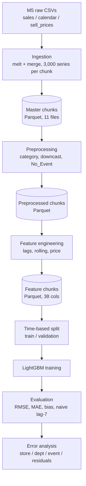

# Architecture

Design principle: **one chunk in memory at a time**. Every stage reads a directory of Parquet chunks and writes another, so each stage can be re-run independently.

| Stage | Code | Notebook | Reads → writes |
|---|---|---|---|
| Ingestion | `src/data/ingestion.py` | 02 | `data/raw` → `data/interim/master_dataset_parquet` |
| Checks | `src/data/validation.py` | 02 | master chunks |
| Preprocessing | `src/data/preprocessing.py` | 04 | → `data/interim/preprocessed_chunks` |
| Features | `src/features/*.py` | 05 | → `data/processed/feature_chunks` |
| Training | `src/models/train.py` | 06, 07 | → `models/` |
| Evaluation | `src/models/evaluate.py` | 08, 09 | `models/tuned`, `data/processed/analysis` |

`configs/config.yaml` holds paths, chunk size, split dates and baseline hyper-parameters; `configs/features.yaml` documents the feature settings.

Notebooks 01–09 are the original, executed narrative (with outputs). `src/` is the same logic extracted without modification; stages 2–4 were verified to reproduce the existing Parquet artifacts on sample series (see `tests/` and `docs/data_pipeline.md`). Notebooks still contain their own copy of the code; they have not been switched to import from `src/`.
